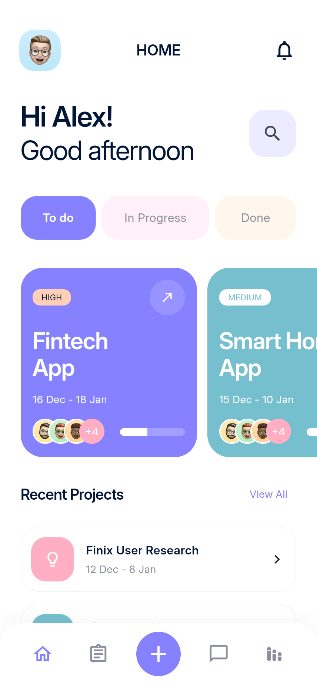
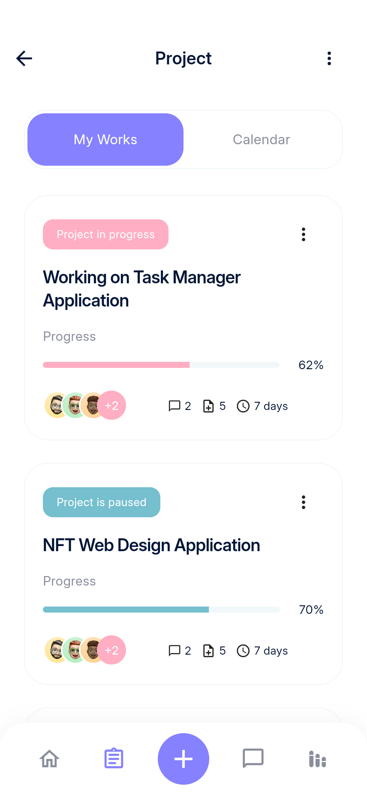
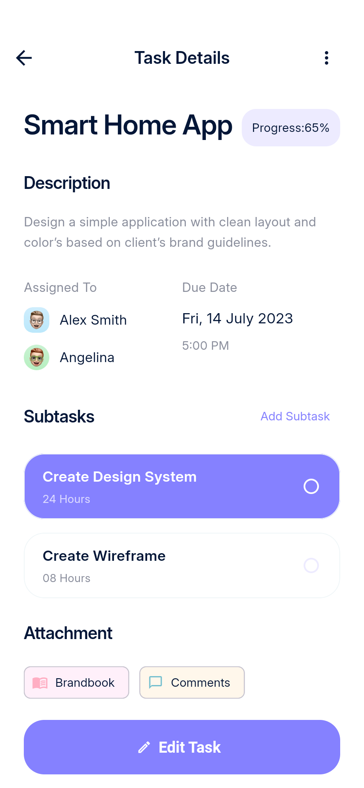

# Taskflow · Flutter 项目管理 App

根据 Pixso「Taskflow - Project Management UI Kit」实现的 Flutter 应用，包含浅色/深色主题、账户、项目、任务、消息、统计与个人中心。

- [完整项目说明与结构架构](docs/项目说明.md)
- [全部 80 张实际运行截图](docs/screenshots/README.md)
- [Pixso 画板对应关系](docs/DESIGN_MAPPING.md)
- [测试记录](docs/TESTING.md)
- [Android 预览安装包](delivery/taskflow-preview.apk)

| 首页 | 项目列表 | 任务详情 |
| --- | --- | --- |
|  |  |  |

```powershell
flutter pub get
flutter run -d emulator-5554
```

本地演示登录：`info@onixlab.net` / `taskflow2026`，验证码：`75824`。数据保存在设备中，未连接登录、邮件、实时消息或音视频服务。完整范围与使用方式见项目说明。
