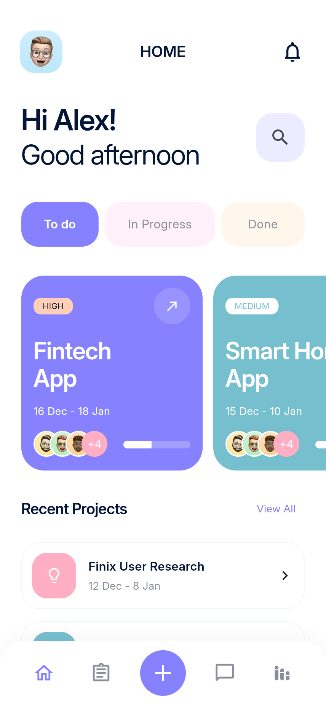
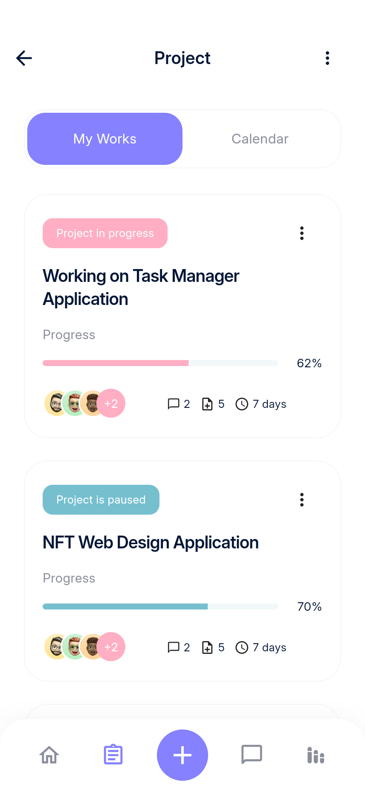
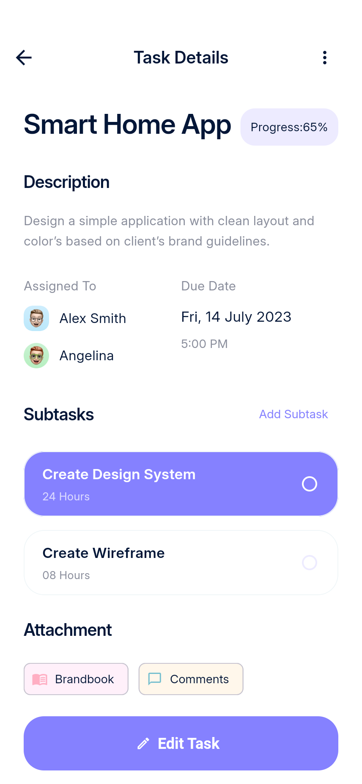
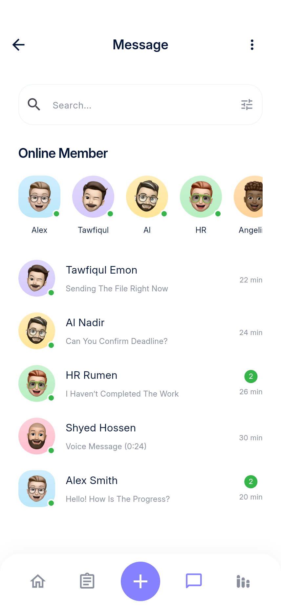
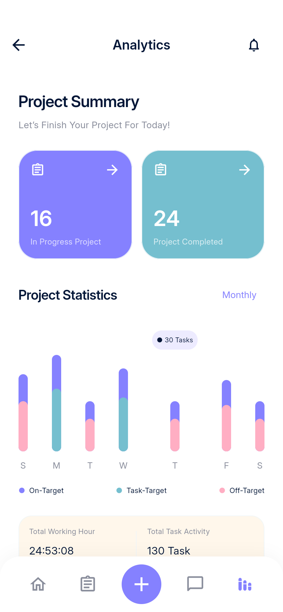
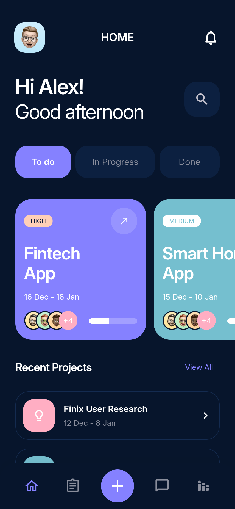

# 实际运行截图索引

40 个页面与状态 × 浅色/深色，共 80 张 PNG。由现有 Android 模拟器运行 Flutter 应用后，通过 Flutter 渲染边界导出实际画面；没有用设计图替代 App 截图。截图测试的目标尺寸为 428 × 926 逻辑像素，导出倍率为 2。

| 界面 | 浅色 | 深色 |
| --- | --- | --- |
| 启动 | [浅色 PNG](light/splash.png) | [深色 PNG](dark/splash.png) |
| 引导一 | [浅色 PNG](light/onboarding.png) | [深色 PNG](dark/onboarding.png) |
| 引导二 | [浅色 PNG](light/onboarding-2.png) | [深色 PNG](dark/onboarding-2.png) |
| 登录（空白） | [浅色 PNG](light/login.png) | [深色 PNG](dark/login.png) |
| 登录（填写） | [浅色 PNG](light/login-filled.png) | [深色 PNG](dark/login-filled.png) |
| 注册（空白） | [浅色 PNG](light/signup.png) | [深色 PNG](dark/signup.png) |
| 注册（填写） | [浅色 PNG](light/signup-filled.png) | [深色 PNG](dark/signup-filled.png) |
| 忘记密码 | [浅色 PNG](light/forgot.png) | [深色 PNG](dark/forgot.png) |
| 验证码（空白） | [浅色 PNG](light/verification.png) | [深色 PNG](dark/verification.png) |
| 验证码（填写） | [浅色 PNG](light/verification-filled.png) | [深色 PNG](dark/verification-filled.png) |
| 邮箱确认 | [浅色 PNG](light/check-email.png) | [深色 PNG](dark/check-email.png) |
| 语言 | [浅色 PNG](light/language.png) | [深色 PNG](dark/language.png) |
| 手机号 | [浅色 PNG](light/phone.png) | [深色 PNG](dark/phone.png) |
| 权限偏好 | [浅色 PNG](light/permissions.png) | [深色 PNG](dark/permissions.png) |
| 首页 | [浅色 PNG](light/home.png) | [深色 PNG](dark/home.png) |
| 通知 | [浅色 PNG](light/notifications.png) | [深色 PNG](dark/notifications.png) |
| 项目列表 | [浅色 PNG](light/projects.png) | [深色 PNG](dark/projects.png) |
| 项目日历 | [浅色 PNG](light/calendar.png) | [深色 PNG](dark/calendar.png) |
| 创建项目 | [浅色 PNG](light/project-new.png) | [深色 PNG](dark/project-new.png) |
| 任务看板 | [浅色 PNG](light/task-board.png) | [深色 PNG](dark/task-board.png) |
| 任务列表 | [浅色 PNG](light/task-list.png) | [深色 PNG](dark/task-list.png) |
| 任务详情 | [浅色 PNG](light/task-details.png) | [深色 PNG](dark/task-details.png) |
| 日期弹层 | [浅色 PNG](light/date.png) | [深色 PNG](dark/date.png) |
| 时间弹层 | [浅色 PNG](light/time.png) | [深色 PNG](dark/time.png) |
| 创建任务 | [浅色 PNG](light/task-new.png) | [深色 PNG](dark/task-new.png) |
| 编辑任务 | [浅色 PNG](light/task-edit.png) | [深色 PNG](dark/task-edit.png) |
| 分配成员 | [浅色 PNG](light/assignees.png) | [深色 PNG](dark/assignees.png) |
| 消息列表 | [浅色 PNG](light/messages.png) | [深色 PNG](dark/messages.png) |
| 聊天 | [浅色 PNG](light/chat.png) | [深色 PNG](dark/chat.png) |
| 视频通话演示 | [浅色 PNG](light/video.png) | [深色 PNG](dark/video.png) |
| 项目统计 | [浅色 PNG](light/analytics.png) | [深色 PNG](dark/analytics.png) |
| 月度回顾 | [浅色 PNG](light/monthly.png) | [深色 PNG](dark/monthly.png) |
| 个人资料 | [浅色 PNG](light/profile.png) | [深色 PNG](dark/profile.png) |
| 编辑资料 | [浅色 PNG](light/profile-edit.png) | [深色 PNG](dark/profile-edit.png) |
| 侧边菜单 | [浅色 PNG](light/menu.png) | [深色 PNG](dark/menu.png) |
| 退出确认 | [浅色 PNG](light/logout.png) | [深色 PNG](dark/logout.png) |
| 设置 | [浅色 PNG](light/settings.png) | [深色 PNG](dark/settings.png) |
| 应用内小组件 | [浅色 PNG](light/widgets.png) | [深色 PNG](dark/widgets.png) |
| 隐私 | [浅色 PNG](light/privacy.png) | [深色 PNG](dark/privacy.png) |
| 帮助 | [浅色 PNG](light/help.png) | [深色 PNG](dark/help.png) |

## 主要页面预览

| 首页 | 项目 | 任务 |
| --- | --- | --- |
|  |  |  |

| 消息 | 统计 | 深色首页 |
| --- | --- | --- |
|  |  |  |
