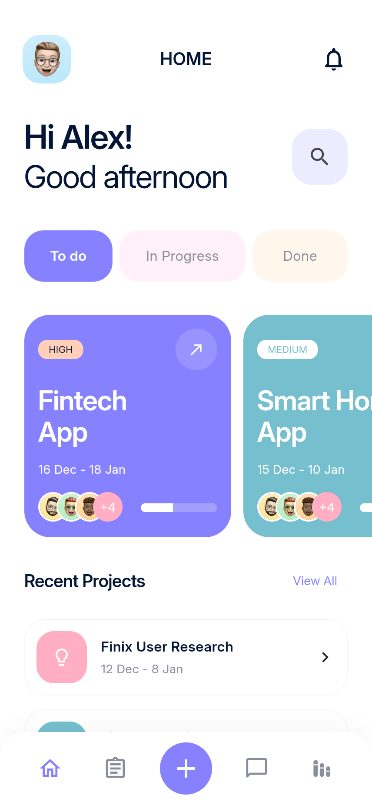
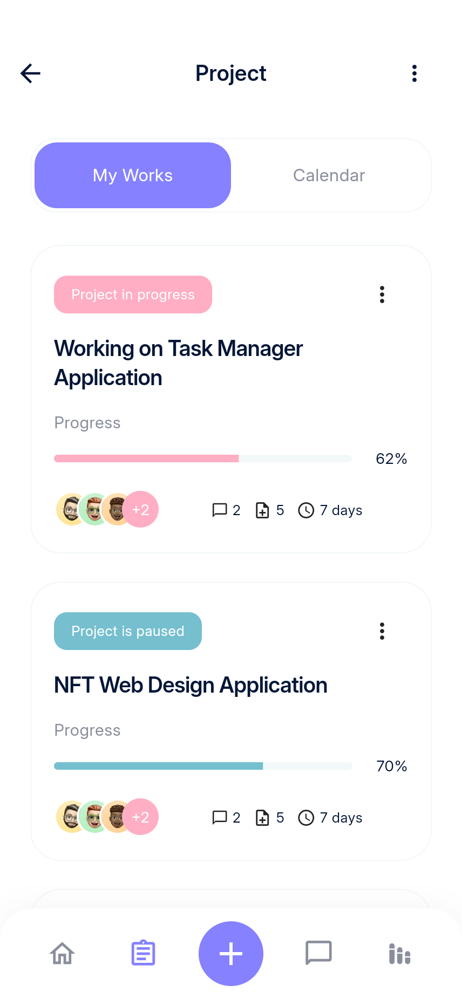
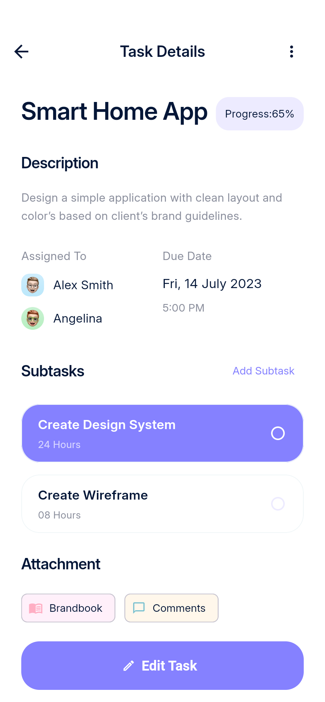
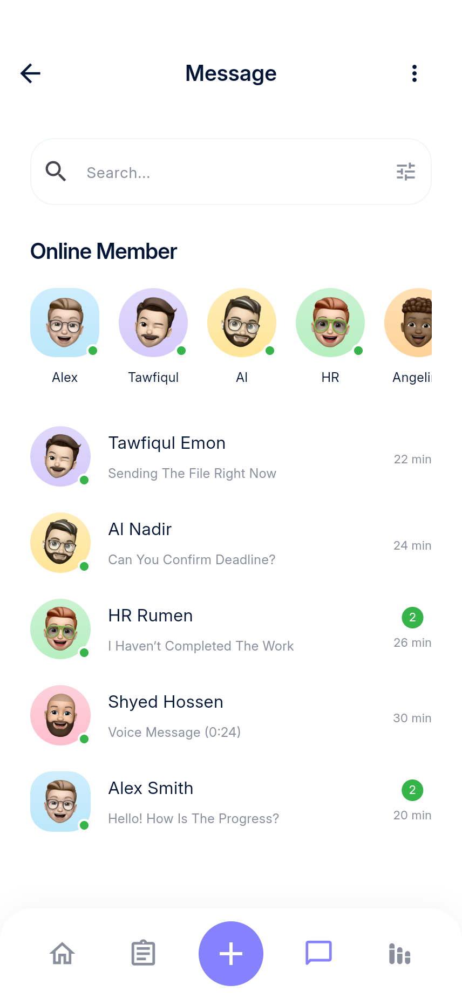
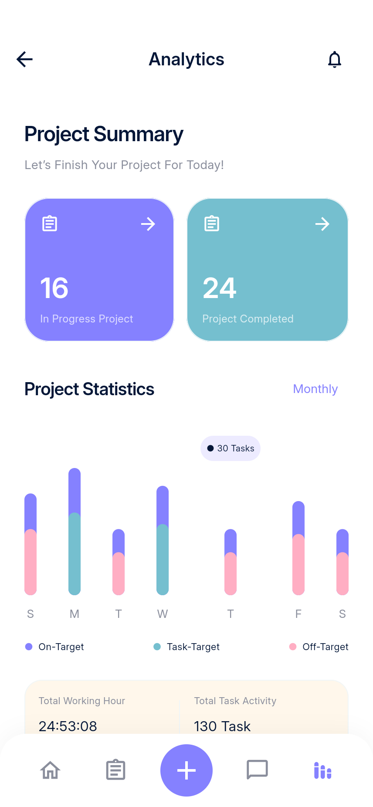
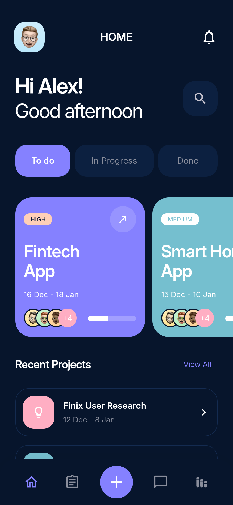
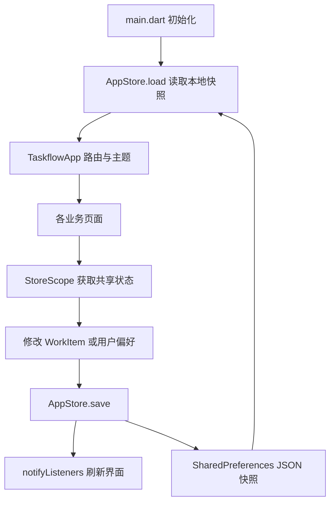

# Taskflow 项目管理 App

基于 Pixso **Taskflow - Project Management UI Kit** 开发的 Flutter 应用。通过 Pixso MCP 读取页面分类、节点、文本、尺寸和颜色，并导出原稿与头像、通话图片等素材。界面以英文原稿为准，项目交付说明使用中文。

## 主要界面

下图均为已有 Android 模拟器中的实际 Flutter 运行截图，原始 PNG 保存在 `docs/screenshots/`，不是设计稿替代图。

<table>
<tr><th>首页</th><th>项目列表</th><th>任务详情</th></tr>
<tr><td></td><td></td><td></td></tr>
<tr><th>消息</th><th>统计</th><th>深色首页</th></tr>
<tr><td></td><td></td><td></td></tr>
</table>

[浏览全部界面截图](screenshots/README.md) · [设计稿对应表](DESIGN_MAPPING.md) · [验证记录](TESTING.md)

## 功能与实现范围

| 模块 | 可操作内容 |
| --- | --- |
| 启动与引导 | 启动页、两步引导、跳过引导 |
| 账户 | 登录与注册表单校验、密码显隐、忘记密码、五位验证码、邮箱确认、语言选择、手机号、权限偏好 |
| 首页 | 状态切换、横向项目卡片、最近项目、搜索入口、通知、侧边菜单 |
| 项目 | 项目列表、日历日期切换、创建项目、日期与时间选择、优先级、邀请成员、暂停与恢复 |
| 任务 | 看板与列表切换、搜索、创建与编辑、详情、成员选择、日期与时间、增添及完成子任务、进度更新 |
| 沟通 | 在线成员、会话搜索、消息详情、本地发送文本、附件预览、通话演示中的静音、摄像头开关与挂断 |
| 统计 | 项目概况、每周图表、月度回顾、优先任务列表 |
| 个人中心 | 查看与编辑资料、退出确认、浅深色切换、偏好保存、帮助和隐私说明 |
| 小组件 | 根据 Widgets 分类补充应用内快捷概览，可进入任务创建及日历 |

本交付为**可运行的本地 UI 应用**。项目、任务、子任务、日期时间、资料、主题与消息通过 SharedPreferences 保存到设备。各任务的子任务完成状态与截止时间独立保存。列表与详情使用同一份任务对象，编辑后立即反映到列表。

未提供服务端，因此登录为本地演示入口；输入有效格式邮箱和至少 6 位密码即可进入。验证码演示值为 **75824**。Google / Apple 登录、邮件与短信发送、真实身份验证、Face ID、系统推送、实时聊天与音视频未接入服务。权限开关仅保存偏好；通话图片和音频/视频预览不产生真实通话、录音或媒体播放。消息列表中的联系人用于演示同一条本地示例会话。图表与首页重点卡片保留原稿示例数据，尚未聚合真实工时或按项目过滤全部任务。

语言页保存语言偏好，界面仍使用设计稿英文，未声明实现完整多语言翻译。Widgets 为应用内页面，未实现 Android 桌面或 iOS 系统小组件。

## 设计来源与适配

Pixso 文件包括 `👋 Onixlab`、`🌝 Light Mode`、`🌚 Dark Mode`、`🔥 Widgets` 和 `🚀 Design System`。Onixlab 为作者介绍，产品开发使用后四个分类。

浅色分类包含 34 个画板，覆盖 11 个业务分组；深色分类包含 35 个画板，增加第二张引导页。登录、注册、验证码中的空白与填写状态复用同一实现；日期、时间与退出确认使用弹层。新增设置、帮助、隐私和小组件预览等可访问页面，使原稿入口形成可操作流程。

原稿基准为 **428 × 926**。应用使用 Flutter 布局、可滚动内容与表单，在较小手机上适配；宽屏预览限制内容最大宽度为 540，保留手机阅读尺度。主题统一管理紫色、青色、粉色、深蓝文字和深色背景，避免每页重复配置。

原稿字体为 SF Pro Display；交付使用随包提供的 **Inter** 静态字体，避免运行时下载，并保持跨设备一致。图标采用 Flutter 内置 Material 图标，部分字形与原稿 Huge-icon 有差异。布局和视觉为原生组件复现，未将整张界面图当作可点击背景。引导页顶部的手机插画作为独立装饰素材使用。

## 项目结构

```text
TaskflowProjectManagement/
├─ lib/
│  ├─ main.dart                 # 初始化 Flutter 与本地数据
│  ├─ app.dart                  # 应用入口、命名路由、主题切换
│  ├─ core/
│  │  ├─ store.dart             # WorkItem、AppStore、JSON 持久化、状态通知
│  │  └─ theme.dart             # 色彩、字体、输入框、按钮、弹层主题
│  ├─ shared/
│  │  └─ widgets.dart           # 页面骨架、底栏、头像、卡片、分段、搜索
│  └─ features/
│     ├─ auth.dart              # 启动、引导、登录、注册、验证、账户设置步骤
│     ├─ workspace.dart         # 首页、项目列表、日历、项目创建
│     ├─ tasks.dart             # 任务看板/列表/详情/编辑、成员、日期时间弹层
│     ├─ communication.dart     # 消息、聊天、通知、通话演示
│     ├─ analytics.dart         # 统计、月度回顾、应用内小组件
│     └─ profile.dart           # 侧边菜单、资料、设置、退出、帮助与隐私
├─ assets/
│  ├─ images/                  # Pixso 导出的实际图片素材
│  └─ fonts/                   # Inter 400/600/700 与 OFL 许可
├─ android/                    # Android 工程与启动图标
├─ web/                        # Flutter Web 入口与图标
├─ test/app_test.dart           # 持久化、状态隔离、表单检查
├─ integration_test/app_test.dart # Android 操作测试与全页面截图
├─ test_driver/integration_test.dart # 保存模拟器截图
├─ docs/
│  ├─ 项目说明.md              # 本文档
│  ├─ DESIGN_MAPPING.md        # 原稿节点 → 页面 → 截图
│  ├─ TESTING.md               # 测试环境、命令及结果
│  ├─ design/                  # 34 张浅色原稿、深色参考与节点清单
│  └─ screenshots/             # 40 × 2 实际运行截图及索引
├─ delivery/                   # Android 安装包
└─ pubspec.yaml / pubspec.lock  # 精简依赖与锁定版本
```

## 架构与数据流



采用按业务划分的轻量结构。`AppStore` 基于 `ChangeNotifier`，`StoreScope` 基于 `InheritedNotifier` 提供依赖；页面临时状态由 `StatefulWidget` 管理。只引入一个运行时插件 `shared_preferences`，未额外引入状态管理、路由或图表框架。

`WorkItem` 负责项目/任务的标题、描述、状态、优先级、成员、排期、进度、子任务及截止时间。`AppStore` 管理集合、演示账户、当前任务与用户偏好。持久化键为 `taskflow.v1`；密码不写入本地快照。退出只更改本地会话标志，不清除已保存的工作内容。

后续接入 API 时，可将 `AppStore.load/save` 的本地读写抽为 Repository，并为项目、任务和会话引入服务端 ID 与项目关系；页面公共组件、主题和路由可继续使用。

## 运行与构建

已在 Windows 环境使用 Flutter 3.47.7 / Dart 3.13.5 完成验证。当前提供 Android 与 Web 工程；iOS 未在本机配置或测试。

```powershell
flutter pub get
flutter run -d emulator-5554
# 也可以在浏览器运行同一 Flutter 应用
flutter run -d chrome
```

设备名称以 `flutter devices` 的实际输出为准。应用启动后会显示引导与登录。演示邮箱可使用 `info@onixlab.net`，密码可使用 `taskflow2026`；这些并非线上账号。

```powershell
flutter analyze
flutter test
flutter drive --driver test_driver/integration_test.dart --target integration_test/app_test.dart -d emulator-5554 --no-enable-impeller
flutter build apk --release --target-platform android-arm64,android-x64
```

截图测试会重置**该应用自身**的演示数据并遍历页面，测试后恢复干净示例；不要用它保留个人录入的数据。发布安装包使用开发签名，适合安装预览；正式商店发布需要配置独立签名和真实服务。

Android 构建固定使用本机已有的 Gradle 8.14、AGP 8.11.1、Kotlin 2.2.20 与 NDK 28.2.13676358，以避免额外下载大型构建工具或系统镜像。Flutter 版本升级后可按[官方 Android 构建迁移说明](https://docs.flutter.dev/release/breaking-changes/migrate-to-built-in-kotlin)统一升级这些配置。

## 素材与精简

头像、通话人物和媒体预览来自本次 Pixso 文件，仅随本项目使用；对外发布前应按原 UI Kit 许可确认素材授权。Inter 来源为 [Google Fonts Inter](https://github.com/google/fonts/tree/main/ofl/inter)，OFL 文本随 `assets/fonts/OFL.txt` 提供。

不新建模拟器、不下载 Android 系统镜像。最终保留源码、依赖锁、文档、实际截图、设计参考与必要安装包；移除默认计数器、无用运行时依赖和大型项目构建缓存；同类页面复用组件，字体静态文件随包提供，原稿导出与对照图保留用于复核。可用 `flutter pub get` 与正常构建命令重新生成缓存。
